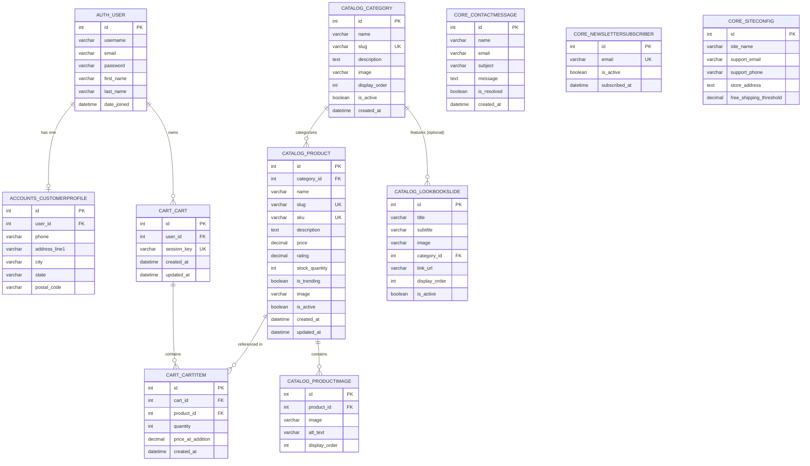

# Database Design Specification
## MAX VIEW — Luxury Fashion E-Commerce Platform

---

### Document Metadata
- **Project Name:** MAX VIEW Luxury Fashion E-Commerce
- **Document Version:** 1.0.0
- **Document Status:** Draft for Review
- **Author:** Winston, System Architect (BMad Method)
- **Stakeholder:** GT
- **Date:** October 14, 2026
- **Location:** `_bmad-output/database/DATABASE_DESIGN.md`
- **Companion Document:** [`_bmad-output/architecture/ARCHITECTURE.md`](file:///c:/Users/91995/OneDrive/Documents/Ecom%20website/_bmad-output/architecture/ARCHITECTURE.md)

---

## 1. Database Overview & Engine Configuration

- **Database Engine:** MySQL 8.0+
- **Default Storage Engine:** `InnoDB` (enables row-level locking, foreign key integrity, and ACID compliance)
- **Default Character Set:** `utf8mb4`
- **Default Collation:** `utf8mb4_unicode_ci` (supports international multilingual characters and emojis)
- **Timezone:** `Asia/Kolkata` (or UTC with Django timezone conversion)

### 1.1 Django MySQL Database Configuration (`settings.py`)
```python
DATABASES = {
    'default': {
        'ENGINE': 'django.db.backends.mysql',
        'NAME': os.getenv('DB_NAME', 'maxview_db'),
        'USER': os.getenv('DB_USER', 'root'),
        'PASSWORD': os.getenv('DB_PASSWORD', ''),
        'HOST': os.getenv('DB_HOST', '127.0.0.1'),
        'PORT': os.getenv('DB_PORT', '3306'),
        'OPTIONS': {
            'charset': 'utf8mb4',
            'init_command': (
                "SET sql_mode='STRICT_TRANS_TABLES,NO_ENGINE_SUBSTITUTION';"
                "SET default_storage_engine=INNODB;"
            ),
        },
    }
}
```

---

## 2. Entity-Relationship (ER) Diagram



---

## 3. Detailed Table Schemas

### 3.1 App: `accounts`

#### Table: `accounts_customerprofile`
Extends Django's `auth_user` with customer profile information.

| Column | Type | Nullable | Default | Constraints / Index | Description |
| :--- | :--- | :---: | :---: | :--- | :--- |
| `id` | `BIGINT AUTO_INCREMENT` | No | — | `PRIMARY KEY` | Profile identifier |
| `user_id` | `INT` | No | — | `UNIQUE`, `FOREIGN KEY (auth_user.id) ON DELETE CASCADE` | Django User relationship |
| `phone` | `VARCHAR(20)` | Yes | NULL | — | Contact telephone number |
| `address_line1` | `VARCHAR(255)` | Yes | NULL | — | Street address |
| `city` | `VARCHAR(100)` | Yes | NULL | — | City name |
| `state` | `VARCHAR(100)` | Yes | NULL | — | State / Province |
| `postal_code` | `VARCHAR(20)` | Yes | NULL | — | Postal / PIN code |
| `created_at` | `DATETIME(6)` | No | `CURRENT_TIMESTAMP` | — | Timestamp of creation |

---

### 3.2 App: `catalog`

#### Table: `catalog_category`
Represents the 4 primary luxury categories (Men's, Women's, Kids', Accessories).

| Column | Type | Nullable | Default | Constraints / Index | Description |
| :--- | :--- | :---: | :---: | :--- | :--- |
| `id` | `BIGINT AUTO_INCREMENT` | No | — | `PRIMARY KEY` | Category identifier |
| `name` | `VARCHAR(100)` | No | — | — | Category title (e.g., "Men's Wear") |
| `slug` | `VARCHAR(100)` | No | — | `UNIQUE`, `INDEX` | URL-safe slug (e.g., `mens-wear`) |
| `description` | `TEXT` | Yes | NULL | — | Merchandising summary |
| `image` | `VARCHAR(255)` | Yes | NULL | — | Category banner visual path |
| `display_order`| `INT` | No | 0 | `INDEX` | Sort order on navigation / UI |
| `is_active` | `TINYINT(1)` | No | 1 | `INDEX` | Visibility toggle |
| `created_at` | `DATETIME(6)` | No | `CURRENT_TIMESTAMP` | — | Creation timestamp |

#### Table: `catalog_product`
Represents individual luxury garments and accessories.

| Column | Type | Nullable | Default | Constraints / Index | Description |
| :--- | :--- | :---: | :---: | :--- | :--- |
| `id` | `BIGINT AUTO_INCREMENT` | No | — | `PRIMARY KEY` | Product identifier |
| `category_id` | `BIGINT` | No | — | `FOREIGN KEY (catalog_category.id) ON DELETE PROTECT`, `INDEX` | Associated category |
| `name` | `VARCHAR(200)` | No | — | `INDEX` | Product name |
| `slug` | `VARCHAR(220)` | No | — | `UNIQUE`, `INDEX` | URL slug |
| `sku` | `VARCHAR(50)` | No | — | `UNIQUE`, `INDEX` | Stock Keeping Unit |
| `description` | `LONGTEXT` | No | — | — | Full editorial product description |
| `price` | `DECIMAL(10,2)` | No | — | `INDEX` | Price in INR (₹) |
| `rating` | `DECIMAL(2,1)` | No | 5.0 | — | Product star rating (1.0 to 5.0) |
| `stock_quantity`| `INT` | No | 100 | — | Available inventory |
| `is_trending` | `TINYINT(1)` | No | 0 | `INDEX` | Flag for Home Page Trending Arrivals |
| `image` | `VARCHAR(255)` | No | — | — | Primary catalog display image |
| `is_active` | `TINYINT(1)` | No | 1 | `INDEX` | Active catalog status |
| `created_at` | `DATETIME(6)` | No | `CURRENT_TIMESTAMP` | `INDEX` | Timestamp added |
| `updated_at` | `DATETIME(6)` | No | `CURRENT_TIMESTAMP ON UPDATE` | — | Timestamp modified |

#### Table: `catalog_productimage`
Supports secondary gallery images for products.

| Column | Type | Nullable | Default | Constraints / Index | Description |
| :--- | :--- | :---: | :---: | :--- | :--- |
| `id` | `BIGINT AUTO_INCREMENT` | No | — | `PRIMARY KEY` | Image identifier |
| `product_id` | `BIGINT` | No | — | `FOREIGN KEY (catalog_product.id) ON DELETE CASCADE`, `INDEX` | Target product |
| `image` | `VARCHAR(255)` | No | — | — | Image file path |
| `alt_text` | `VARCHAR(200)` | Yes | NULL | — | Accessible screen-reader text |
| `display_order`| `INT` | No | 0 | — | Display sorting index |

#### Table: `catalog_lookbookslide`
Powers the horizontal image slider on the Categories page.

| Column | Type | Nullable | Default | Constraints / Index | Description |
| :--- | :--- | :---: | :---: | :--- | :--- |
| `id` | `BIGINT AUTO_INCREMENT` | No | — | `PRIMARY KEY` | Slide identifier |
| `title` | `VARCHAR(150)` | No | — | — | Slide headline |
| `subtitle` | `VARCHAR(255)` | Yes | NULL | — | Curated blurb |
| `image` | `VARCHAR(255)` | No | — | — | High-res editorial slider visual |
| `category_id` | `BIGINT` | Yes | NULL | `FOREIGN KEY (catalog_category.id) ON DELETE SET NULL` | Target category link (optional) |
| `link_url` | `VARCHAR(255)` | Yes | NULL | — | Explicit navigation URL |
| `display_order`| `INT` | No | 0 | `INDEX` | Horizontal sequence order |
| `is_active` | `TINYINT(1)` | No | 1 | `INDEX` | Visibility toggle |

---

### 3.3 App: `cart`

#### Table: `cart_cart`
Represents an active shopping session container.

| Column | Type | Nullable | Default | Constraints / Index | Description |
| :--- | :--- | :---: | :---: | :--- | :--- |
| `id` | `BIGINT AUTO_INCREMENT` | No | — | `PRIMARY KEY` | Cart identifier |
| `user_id` | `INT` | Yes | NULL | `FOREIGN KEY (auth_user.id) ON DELETE CASCADE`, `INDEX` | Authenticated owner |
| `session_key` | `VARCHAR(40)` | Yes | NULL | `UNIQUE`, `INDEX` | Guest visitor session cookie |
| `created_at` | `DATETIME(6)` | No | `CURRENT_TIMESTAMP` | — | Initialized timestamp |
| `updated_at` | `DATETIME(6)` | No | `CURRENT_TIMESTAMP ON UPDATE` | — | Last modified timestamp |

#### Table: `cart_cartitem`
Line items contained within an active cart.

| Column | Type | Nullable | Default | Constraints / Index | Description |
| :--- | :--- | :---: | :---: | :--- | :--- |
| `id` | `BIGINT AUTO_INCREMENT` | No | — | `PRIMARY KEY` | Line item identifier |
| `cart_id` | `BIGINT` | No | — | `FOREIGN KEY (cart_cart.id) ON DELETE CASCADE`, `INDEX` | Parent cart |
| `product_id` | `BIGINT` | No | — | `FOREIGN KEY (catalog_product.id) ON DELETE CASCADE`, `INDEX` | Selected product |
| `quantity` | `INT UNSIGNED` | No | 1 | — | Quantity chosen |
| `price_at_addition`| `DECIMAL(10,2)`| No | — | — | Snapshot price at time of addition |
| `created_at` | `DATETIME(6)` | No | `CURRENT_TIMESTAMP` | — | Addition timestamp |

---

### 3.4 App: `core`

#### Table: `core_contactmessage`
Stores customer inquiries submitted via the Contact Us form.

| Column | Type | Nullable | Default | Constraints / Index | Description |
| :--- | :--- | :---: | :---: | :--- | :--- |
| `id` | `BIGINT AUTO_INCREMENT` | No | — | `PRIMARY KEY` | Message identifier |
| `name` | `VARCHAR(150)` | No | — | — | Sender name |
| `email` | `VARCHAR(254)` | No | — | `INDEX` | Sender email address |
| `subject` | `VARCHAR(200)` | No | — | — | Subject line |
| `message` | `LONGTEXT` | No | — | — | Ingested query body |
| `is_resolved` | `TINYINT(1)` | No | 0 | `INDEX` | Admin triage flag |
| `created_at` | `DATETIME(6)` | No | `CURRENT_TIMESTAMP` | `INDEX` | Submission timestamp |

#### Table: `core_newslettersubscriber`
Maintains customer newsletter subscription sign-ups.

| Column | Type | Nullable | Default | Constraints / Index | Description |
| :--- | :--- | :---: | :---: | :--- | :--- |
| `id` | `BIGINT AUTO_INCREMENT` | No | — | `PRIMARY KEY` | Subscriber identifier |
| `email` | `VARCHAR(254)` | No | — | `UNIQUE`, `INDEX` | Validated email address |
| `is_active` | `TINYINT(1)` | No | 1 | `INDEX` | Subscription status |
| `subscribed_at`| `DATETIME(6)` | No | `CURRENT_TIMESTAMP` | — | Timestamp of opt-in |

#### Table: `core_siteconfig`
Stores editable site-wide variables to avoid hardcoded template literals.

| Column | Type | Nullable | Default | Description |
| :--- | :--- | :---: | :---: | :--- |
| `id` | `BIGINT AUTO_INCREMENT` | No | — | Singleton identifier (`id=1`) |
| `site_name` | `VARCHAR(100)` | No | `'MAX VIEW'` | Brand name |
| `support_email`| `VARCHAR(254)` | No | `'maxview1@gmail.com'` | Customer support email |
| `support_phone`| `VARCHAR(50)` | No | `'1234567890'` | Contact telephone number |
| `store_address`| `TEXT` | No | `'123@ Tirupur, Tamil Nadu, INDIA'` | Physical store location |
| `free_shipping_threshold` | `DECIMAL(10,2)` | No | 999.00 | Free shipping threshold in ₹ |

---

## 4. Performance Indexes & Optimization Strategy

1. **Composite Indexes for Catalog Querying:**
   - `catalog_product`: `INDEX idx_cat_active (category_id, is_active)` → Eliminates full table scans during category filtering.
   - `catalog_product`: `INDEX idx_trending_active (is_trending, is_active)` → Instant query execution for Home Page Trending Arrivals.
2. **Text Search Optimization:**
   - `catalog_product`: Full-text or multi-column index on `(name, slug)` to support sub-millisecond keyword lookup.
3. **Cart Constraints & Concurrency:**
   - `cart_cartitem`: `UNIQUE KEY uq_cart_product (cart_id, product_id)` → Enforces single row per item with quantity incrementing, preventing duplicate row race conditions.
4. **Delete Cascade Policies:**
   - Deleting a `Category` is protected (`ON DELETE PROTECT`) to prevent accidental mass deletion of attached products.
   - Deleting a `Product` removes its secondary gallery images (`ON DELETE CASCADE`) and associated cart items.

---

## 5. Seed Data Plan (Initial Fixtures)

### 5.1 Categories (`catalog_category`)
1. **Men's Wear** (`slug: mens-wear`, `display_order: 1`)
2. **Women's Wear** (`slug: womens-wear`, `display_order: 2`)
3. **Kids' Wear** (`slug: kids-wear`, `display_order: 3`)
4. **Accessories** (`slug: accessories`, `display_order: 4`)

### 5.2 Initial Featured Products (`catalog_product`)
| Category | Product Name | SKU | Price | Rating | Trending? |
| :--- | :--- | :--- | :--- | :---: | :---: |
| **Men's Wear** | Heritage Tailored Suit / Classic Linen Shirt | `MV-MEN-001` | ₹499.00 | 4.8 | Yes |
| **Women's Wear** | Silk Couture Evening Dress | `MV-WOM-001` | ₹599.00 | 4.9 | Yes |
| **Kids' Wear** | Signature Cotton Ensemble | `MV-KID-001` | ₹499.00 | 4.7 | Yes |
| **Accessories** | Handcrafted Leather Chronograph & Belt | `MV-ACC-001` | ₹899.00 | 5.0 | Yes |

---

## 6. Migration & Deployment Sequence

1. **Step 1:** Establish MySQL Database `maxview_db` with `utf8mb4` character set.
2. **Step 2:** Author Django models across `core`, `accounts`, `catalog`, `cart`.
3. **Step 3:** Generate initial migrations: `python manage.py makemigrations`.
4. **Step 4:** Execute schema creation: `python manage.py migrate`.
5. **Step 5:** Seed baseline categories, sample products, site config, and lookbook slides via Django data migration or fixture: `python manage.py loaddata initial_catalog.json`.

---

## 7. Approval & Governance

- **Architect:** Winston, System Architect 🏗️
- **Status:** Complete for Review
- **Approval Gate:** Stakeholder (GT) sign-off required prior to executing environment creation, migrations, or application code.
